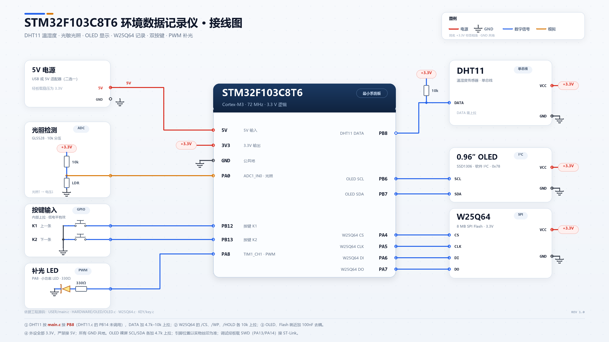

# 环境数据记录仪（Environmental Data Records）

基于 **STM32F103C8T6** 的离线环境数据记录仪：DHT11 采集温湿度，光敏电阻采集光照，0.96″ OLED 实时显示，W25Q64 Flash 掉电保存；两个按键即可在现场翻查历史，环境变暗时自动 PWM 补光。



> 接线图另提供 [SVG 矢量版](wiring_diagram.svg)。图中引脚与 `User/main.c`、`Hardware/*` 中的定义一致。

---

## 1. 项目解决什么问题

监测温湿度、光照时，常见方案有两种：

- **电脑 + 串口/上位机**：必须一直连着电脑，断电就停止记录，也不方便长期放在现场；
- **成品数据记录仪**：价格较高，导出数据往往还要专用软件。

这个项目把「采集 → 显示 → 存储 → 回看」做进一块低成本的最小系统板：

- **离线运行**：不需要电脑、网络或上位机，上电即开始记录；
- **掉电不丢**：每条记录写入 W25Q64 Flash，断电后重新上电会自动接着已有记录往后写；
- **现场可查**：不拆机、不接串口，用两个按键就能在 OLED 上逐条翻看历史；
- **自动补光**：环境变暗时，PA8 上的 LED 按亮度自动开启并调亮，可作夜间补光/夜灯；
- **适合教学**：一个工程里覆盖 GPIO、ADC、TIM PWM、软件 I2C、软件 SPI、Flash 记录、按键状态机等常见外设用法。

适合课程设计、毕业设计原型，以及温室、储物间、机房角落等场景的短期环境监测。

**它不是什么**：没有 RTC，记录中没有真实日期时间；没有联网/蓝牙；也没有上位机导出功能，历史数据只能通过 OLED 查看，或自行读取 Flash。

---

## 2. 主要功能

| 功能 | 实现与行为 |
|---|---|
| 温湿度采集 | DHT11 单总线接 **PB8**；每次读 5 字节并校验和，校验失败或无响应返回 0 |
| 光照采集 | GL5528 光敏电阻 + 10 kΩ 分压接 **PA0**；ADC1 注入通道，由 TIM1 更新事件触发，13.5 周期采样 |
| 实时显示 | 0.96″ SSD1306 OLED（128×64），4 行 × 16 字符、8×16 字体，软件 I2C（PB6/PB7，地址 0x78） |
| 掉电记录 | 每条 16 字节，CRC16 校验；顺序写入 W25Q64 起始 1 MB，最多 **65535 条** |
| 上电续写 | 启动时从地址 0 逐条扫描，遇到空白或 CRC 错误停止；之后从最后一条之后继续写 |
| 历史浏览 | K1 上一条、K2 下一条；长按连发；K2 双击跳到最新；浏览时采集和写入不中断 |
| 清空记录 | 上电时同时按住 K1+K2 保持 3 秒，擦除日志区，`SAVE` 归零 |
| 自动补光 | ADC > 2200 时，TIM1_CH1（**PA8**）输出 1 kHz PWM，越暗占空比越大 |
| 上电检查 | 读取 W25Q64 JEDEC ID（期望 `0xEF4017`）；ID 不符不会阻止程序运行 |

主循环节奏：读 DHT11（约 20 ms）→ 等待 1.2 s（期间扫描按键）→ 采样光照、写记录 → 等待 2 s，合计 **约 3.2 秒一条**。按此估算，写满 65535 条约需 **2～3 天**，日志区只占 W25Q64 8 MB 的前 1 MB。

> `ts` 字段每轮加 2，只是上电后的轮次计数，不是真实时间（见 [已知限制](#7-已知限制)）。

---

## 3. 安装方法

### 3.1 硬件清单

| 器件 | 型号 / 参数 | 数量 | 备注 |
|---|---|---|---|
| 主控 | STM32F103C8T6 最小系统板 | 1 | 64 KB Flash / 20 KB RAM，Cortex-M3 |
| 温湿度 | DHT11 模块 | 1 | 单总线；模块一般自带 10 kΩ 上拉 |
| 光照 | GL5528 光敏电阻 + 10 kΩ 电阻 | 1 | 与 10 kΩ 组成分压 |
| 显示 | 0.96″ OLED，SSD1306，128×64，I²C | 1 | 地址 `0x78` |
| 存储 | W25Q64 模块（64 Mbit / 8 MB） | 1 | SPI，JEDEC ID `0xEF4017` |
| 按键 | 6×6 轻触按键 | 2 | 一端接 GND，内部上拉 |
| 补光 | LED + 330 Ω 电阻 | 1 | 接 PA8 |
| 调试 | ST-Link V2 | 1 | SWD 接口 |
| 电源 | 5 V USB 或 3.3 V | 1 | 外设一律 3.3 V |

### 3.2 接线

| STM32 引脚 | 连接到 | 说明 |
|---|---|---|
| PB8 | DHT11 DATA | 单总线，DATA 需 4.7–10 kΩ 上拉 |
| PB6 | OLED SCL | 软件 I²C |
| PB7 | OLED SDA | 软件 I²C |
| PA4 | W25Q64 /CS | 软件 SPI 片选 |
| PA5 | W25Q64 CLK | 软件 SPI 时钟 |
| PA6 | W25Q64 DI | MOSI |
| PA7 | W25Q64 DO | MISO |
| PA0 | 光敏分压中点 | ADC1_IN0 |
| PB12 | K1（上一条） | 内部上拉，按下为低 |
| PB13 | K2（下一条） | 内部上拉，按下为低 |
| PA8 | LED（串 330 Ω 到 GND） | TIM1_CH1 PWM，高电平点亮 |
| PA13 / PA14 | ST-Link SWDIO / SWCLK | 下载与调试 |

接线注意：

- 所有外设均为 **3.3 V**，严禁接 5 V；所有 GND 必须共地。
- W25Q64 的 `/CS`、`/WP`、`/HOLD` 各加 10 kΩ 上拉；`/WP` 被拉低时状态寄存器无法写入。
- OLED、Flash 就近加 100 nF 去耦；OLED 模块通常自带 I²C 上拉，裸屏需在 SCL/SDA 各加 4.7 kΩ。
- 若 K1/K2 接反，只需交换 `Hardware/KEY/key.c` 中 `BTN_PREV_PIN` 与 `BTN_NEXT_PIN` 两行。

### 3.3 软件环境

| 项目 | 版本 / 说明 |
|---|---|
| IDE | Keil MDK-ARM 5.36（µVision 5） |
| 编译器 | ARM Compiler 5（V5.06 update 7）。工程 `uAC6=0`，是 AC5 工程；只装 AC6 时需另装 AC5 或切换编译器 |
| 器件支持包 | Keil.STM32F1xx_DFP 2.4.1 |
| 下载器 | ST-Link（工程已配置 ST-Link Debugger） |
| 时钟 | 外部 8 MHz 晶振，PLL ×9 → SYSCLK 72 MHz（工程默认 `HSE_VALUE`） |
| 外设库 | STM32F10x 标准外设库 V3.5.0（已包含在 `Library/`） |

> 工程按 8 MHz HSE、PLL ×9 得到 72 MHz。若实物晶振不是 8 MHz，需要同时修改 `HSE_VALUE` 和 `system_stm32f10x.c` 中的 PLL 倍频配置。

### 3.4 编译与烧录

1. 双击 `Project.uvprojx` 打开工程（Target 1，器件 STM32F103C8）。
2. `Project → Build Target`（F7）。正常结果为 `0 Error(s), 0 Warning(s)`，输出 `Objects\Project.axf`。
3. `Options for Target → Debug` 选择 **ST-Link Debugger**；`Utilities → Settings` 中的 Flash 算法已配置为 `STM32F10x_128`。
4. 按接线表连接 SWD（PA13/PA14/GND/3.3V），`Flash → Download`（F8），复位运行。
5. 工程默认 **不生成 .hex**（`Create HEX File` 未勾选）。如需 hex，在 `Options for Target → Output` 勾选后重新编译，再用 STM32CubeProgrammer 等工具烧录 `Objects\Project.hex`。
6. 编译后会生成 `Objects\Project.axf`（ROM 约 9.1 KB / 64 KB，RAM 约 1.9 KB / 20 KB）；构建产物默认不纳入版本库，修改代码后请重新编译。

### 3.5 首次上电检查

- OLED 第 1 行出现 `LIGHT:`，第 3/4 行为 `SAVE:0000` / `NO DATA`（空片）。
- DHT11 上电后约需 1 秒稳定，第一轮可能显示 `Read Failure`，下一轮会自动恢复。
- OLED 不亮：检查 PB6/PB7、3.3 V 和模块地址 `0x78`。
- 一直不产生记录：检查 DHT11 数据线、W25Q64 的 `/WP`、`/HOLD` 上拉和共地。
- 记录较多时上电会先扫描 Flash，屏幕可能空白数十秒，属正常现象。

---

## 4. 使用方法

### 4.1 启动流程

1. 上电或按复位，OLED 初始化并清屏。
2. 若此时 **K1、K2 同时按住**，第 2 行显示 `CLEAR? HOLD 3S`；保持 3 秒后松开按键，程序清空记录并显示 `LOG CLEARED`，中途松开则取消。
3. 扫描 Flash 中已有记录（记录越多越慢，写满时约 30–45 秒，期间屏幕无提示）。
4. 显示 `LIGHT:` 和最新一条记录，进入主循环，约每 3.2 秒采集一轮。

> 清空操作的顺序必须是**先按住两个键，再上电/复位**；上电后再按无效。

### 4.2 屏幕布局

正常记录时的典型画面（4 行 × 16 字符）：

```text
LIGHT: 21%
temp:24 hum58
SAVE:0002
F:24 H:58 L:021
```

| 行 | 格式 | 含义 |
|---|---|---|
| 1 | `LIGHT: NN%` | 当前光照相对值，0–100，越亮越大，每轮刷新 |
| 2 | `temp:NN humNN` | 当前温度（°C）与湿度（%RH），DHT11 整数分辨率；读取失败显示 `Read Failure` |
| 3 | `SAVE:NNNN` | 当前显示的是第几条记录（从 1 开始，固定 4 位）；无记录时 `SAVE:0000` |
| 4 | `F:NN H:NN L:NNN` | 该条记录的温度 / 湿度 / 光照；无记录时 `NO DATA`，CRC 错误时 `READ ERR` |

两个细节与源码一致：

- 第 2 行源码把 `" humi:"` 写在湿度数值所在的列上，实际显示为 `hum56` 而不是 `humi:56`。
- 第 1 行的 `LIGHT:` 与数字之间空 1 列（第 7 列），数字固定 2 位。

第 1/2 行是**实时值**，第 3/4 行是 **Flash 中的记录**；浏览历史时两者可能不同步，这是正常的。

### 4.3 按键操作

| 操作 | K1（PB12，上一条） | K2（PB13，下一条） |
|---|---|---|
| 单击 | 显示上一条记录 | 显示下一条记录 |
| 长按 ≥ 0.5 s | 连续向前翻（120 ms/条，10 条后 60 ms/条） | 连续向后翻 |
| 双击（300 ms 内） | 无特殊动作，等同再按一次 | 立即跳到最新一条 |
| 处于最新一条时 | 退出「跟随最新」，显示上一条 | 无动作 |

- 按键消抖 15 ms，长按 500 ms 后进入连发，双击判定窗口 300 ms。
- 浏览历史时，第 1/2 行仍显示实时值，第 3/4 行停在所查看的记录；后台仍会继续采样并写入新记录。
- 从历史翻到最新一条后，会自动恢复「跟随最新」，新记录写入时第 3/4 行随之刷新。

### 4.4 查看历史记录

`SAVE` 是记录的绝对序号，不是本次上电的序号：

- 空片：`SAVE:0000` + `NO DATA`。
- 第 1 条：`SAVE:0001`；最新一条为 `SAVE:000N`。
- 断电重启后编号保留，新记录接着往后编号（前提是记录区未写满）。

`ts` 字段只存在于 Flash 中，屏幕不显示；它每轮加 2，用于区分记录先后。

### 4.5 清空记录

1. 断开电源（或按住复位键）。
2. 同时按住 K1 和 K2。
3. 上电或松开复位，保持两个键按住。
4. 第 2 行出现 `CLEAR? HOLD 3S` 后继续按住 3 秒。
5. 松开按键；程序检测到松开后执行清空，显示 `LOG CLEARED`，第 3/4 行变为 `SAVE:0000` / `NO DATA`。

注意事项：

- 顺序必须是「先按键，再上电/复位」；程序只在启动时检查一次双键。
- 中途松开任意一个键会取消清空。
- 清空只擦除日志区的第一个 4 KB 扇区，后续扇区里的旧数据在物理上仍然存在，但会被当作空白区忽略；下一次顺序写入到相应扇区时才会擦除覆盖。
- 清空后旧记录无法再从屏幕恢复。

### 4.6 自动补光

- 当 ADC 原始值 > 2200（约 `LIGHT` 低于 46%）时开始点亮；
- 亮度按 `CCR = (ADC - 2200) × 1000 / (4095 - 2200)` 线性增加，越暗越亮；
- PWM 频率 1 kHz，占空比 = `CCR / 1000`；ADC ≤ 2200 时 `CCR = 0`，LED 熄灭；
- 阈值和斜率直接写在 `User/main.c` 中，可按实际传感器和灯珠调整。

### 4.7 常见现象

| 现象 | 原因 | 处理 |
|---|---|---|
| 上电先显示 `Read Failure` 约 3 秒 | DHT11 上电稳定时间不足 1 s，首轮读取失败 | 正常，下一轮自动恢复 |
| 上电后屏幕空白数十秒 | 正在扫描已有记录 | 等待；记录越多越慢 |
| `SAVE` 不增加 | 该轮 DHT11 读取失败（不写记录），或记录已满 65535 条 | 检查 DHT11；清空记录 |
| `LIGHT` 满亮时显示 `00%` | 百分比固定 2 位，100% 被截成 `00` | 已知显示限制，见第 7 节 |
| 记录重启后“消失” | Flash 中该位置已有 CRC 错误记录，扫描在此停止 | 清空后重新记录；检查写入时是否断电 |
| 换一块 W25Q64 后写不进 | 芯片 SR2 的 CMP 位被置 1，处于全片写保护 | 手动调用 `W25Q64_ClearCMP()`，并确认 `/WP` 为高 |

---

## 5. 输入输出示例

> 本设备没有命令行或文件式输入：**输入**是 DHT11、光敏电阻和按键，**输出**是 OLED 画面、W25Q64 中的记录和 PA8 的 PWM。

### 5.1 输入与换算

以两条连续记录为例：

| 输入 | 示例值 | 设备处理 | 结果 |
|---|---|---|---|
| DHT11 | 25 °C / 56 %RH | 校验和通过 | `temp=25`、`humi=56`，参与写记录 |
| DHT11 | 校验和错误或无响应 | 返回 0 | 第 2 行 `Read Failure`，该轮不写记录 |
| 光敏电阻 | ADC = 2000 | `LIGHT = (4095-2000)×100/4095 = 51` | 显示 `51%`，补光 `CCR=0` |
| 光敏电阻 | ADC = 3200 | `LIGHT = 21`，`CCR = (3200-2200)×1000/1895 = 527` | 显示 `21%`，补光占空比 52.7% |
| K1 | 单击 | `LogView_Prev` | `SAVE` 减 1，显示上一条 |
| K2 | 双击 | `LogView_Latest` | 跳回最新一条 |

ADC 原始值与显示、补光的对应关系：

| ADC 原始值 | `LIGHT` 显示 | 补光 CCR | 占空比 |
|---|---|---|---|
| 1000（很亮） | 75% | 0 | 0% |
| 2000 | 51% | 0 | 0% |
| 2200（阈值） | 46% | 0 | 0% |
| 3200 | 21% | 527 | 52.7% |
| 4000 | 2% | 949 | 94.9% |
| 4095（全暗） | 0% | 1000 | 100% |

> `LIGHT` 是相对值，不是标定过的 lux；满亮（ADC = 0）时计算值为 100%，但屏幕按 2 位显示成 `00%`。

### 5.2 输出：OLED 画面

**（1）已有 2 条记录、跟随最新时**（第 1/2 行为实时值，第 3/4 行为最新记录）：

```text
LIGHT: 21%
temp:24 hum58
SAVE:0002
F:24 H:58 L:021
```

**（2）按 K1 翻到第 1 条时**（第 1/2 行仍是当前实时值，与第 4 行不同）：

```text
LIGHT: 21%
temp:24 hum58
SAVE:0001
F:25 H:56 L:051
```

**（3）空片、尚未写入第一条记录时**（第 1/2 行已有实时值，第 3/4 行仍是初始状态）：

```text
LIGHT: 51%
temp:25 hum56
SAVE:0000
NO DATA
```

**（4）冷启动第一轮，DHT11 尚未稳定**（该轮不写记录）：

```text
LIGHT: 51%
Read Failure
SAVE:0000
NO DATA
```

**（5）清空记录时**：第 2 行先显示 `CLEAR? HOLD 3S`；保持 3 秒后松开按键，第 2 行显示 `LOG CLEARED`，随后变为 `SAVE:0000` / `NO DATA`。

### 5.3 输出：Flash 记录

每条记录 16 字节，按小端存放；第 i 条（从 0 开始，`SAVE:0001` 对应 i=0）的地址为 `0x000000 + i × 16`。

| 偏移 | 字段 | 类型 | 示例（第 1 条） | 说明 |
|---|---|---|---|---|
| 0 | `ts` | u32 | `0x00000002` | 上电后的轮次计数，每轮 +2，不是真实时间 |
| 4 | `light` | u16 | `0x0033`（51） | 光照百分比 0–100 |
| 6 | `temp` | u8 | `0x19`（25） | 温度 °C |
| 7 | `humi` | u8 | `0x38`（56） | 湿度 %RH |
| 8 | `flags` | u8 | `0x00` | 预留，当前恒为 0 |
| 9 | `rsv` | u8 | `0x00` | 预留 |
| 10 | `crc` | u16 | `0x5A0B` | 前 10 字节的 CRC16/CCITT-FALSE |
| 12 | `rsv2` | u32 | `0x00000000` | 预留 |

上例两条记录在 Flash 中的实际内容：

```text
偏移      00 01 02 03 04 05 06 07 08 09 0A 0B 0C 0D 0E 0F
0x000000  02 00 00 00 33 00 19 38 00 00 0B 5A 00 00 00 00
0x000010  04 00 00 00 15 00 18 3A 00 00 89 89 00 00 00 00
```

- 第 1 条：`ts=2`、`light=51`、`temp=25`、`humi=56`、`crc=0x5A0B`（小端存为 `0B 5A`）。
- 第 2 条：`ts=4`、`light=21`、`temp=24`、`humi=58`、`crc=0x8989`（小端存为 `89 89`）。

CRC 算法为 CRC-16/CCITT-FALSE（多项式 `0x1021`、初值 `0xFFFF`、不反转、无异或），对每条记录的前 10 字节计算。可用下面的 Python 代码核对：

```python
def crc16_ccitt_false(data: bytes) -> int:
    crc = 0xFFFF
    for b in data:
        crc ^= b << 8
        for _ in range(8):
            crc = ((crc << 1) ^ 0x1021) & 0xFFFF if crc & 0x8000 else (crc << 1) & 0xFFFF
    return crc

assert crc16_ccitt_false(bytes.fromhex("02 00 00 00 33 00 19 38 00 00")) == 0x5A0B
assert crc16_ccitt_false(bytes.fromhex("04 00 00 00 15 00 18 3A 00 00")) == 0x8989
```

> 示例对应冷启动：第一轮 DHT11 尚未稳定、不写记录，所以第 1 条记录的 `ts` 是 2。若传感器一直供电、只按复位使首轮就成功，第 1 条 `ts` 为 0，之后仍每轮 +2。

### 5.4 输出：PWM 补光

以 ADC = 3200 为例：

- `CCR1 = 527`，`ARR = 999`，`PSC = 71`；
- PWM 频率 = 72 MHz / (71+1) / (999+1) = **1 kHz**；
- 占空比 = 527 / 1000 ≈ **52.7%**，PA8 上的 LED 半亮。

ADC ≤ 2200 时 `CCR1 = 0`，LED 完全熄灭；ADC = 4095 时 `CCR1 = 1000`，LED 恒亮。

---

## 6. 项目结构

| 路径 | 说明 |
|---|---|
| `Project.uvprojx` | Keil MDK 工程（Target 1，STM32F103C8） |
| `User/main.c` | 主循环：PB8 上的 DHT11 读取、ADC 光照、OLED 刷新、补光 PWM、写记录 |
| `User/stm32f10x_it.c` | 中断向量（SysTick 中断为空，延时使用轮询） |
| `Hardware/OLED/` | SSD1306 驱动与 8×16 字库（软件 I2C） |
| `Hardware/KEY/` | 按键消抖、长按连发、双击状态机与日志浏览逻辑 |
| `Hardware/W25Q64/` | 软件 SPI 驱动 + 日志层（CRC16、追加、读取、清空） |
| `Hardware/DHT11/` | 另一版 PB14 DHT11 驱动，**当前主程序未调用**（主程序用的是 `main.c` 里的 PB8 版本） |
| `System/delay/` | SysTick 微秒/毫秒延时（正点原子模板） |
| `System/usart/` | 串口 / printf 模板，当前未使用 |
| `System/sys/` | 位带、WFI 等系统辅助函数 |
| `Start/` | CMSIS 启动文件与 STM32F10x 寄存器定义 |
| `Library/` | STM32F10x 标准外设库 V3.5.0 |
| `Objects/`、`Listings/` | Keil 构建产物（`Project.axf`、map、构建日志等，已被 `.gitignore` 排除） |
| `wiring_diagram.png` / `.svg` | 接线图 |

---

## 7. 已知限制

1. **没有 RTC**：`ts` 每轮 +2、掉电归零，不能当作日期时间；跨次上电的记录只能靠 `SAVE` 序号区分先后。
2. **记录上限 65535 条**（约 1 MB，按约 3.2 s 一条约 2～3 天）。写满后 `Log_Append()` 返回 4，主程序未处理，界面继续显示但不再新增记录。
3. **上电扫描慢**：记录越多启动越慢，接近写满时约 30–45 秒，期间屏幕空白且没有进度提示。
4. **显示位宽固定**：`LIGHT` 只有 2 位，100% 会显示成 `00%`；`SAVE` 只有 4 位，≥ 10000 时只显示低 4 位（65535 显示为 `5535`）；第 2 行湿度标签与数值重叠，显示为 `humNN`。
5. **DHT11 失败不补记录**：该轮只显示 `Read Failure`，不写 Flash；光照仍会采样和显示。冷启动第一轮常因此失败。
6. **写入瞬间断电**：可能留下 CRC 错误的半条记录；下次上电扫描遇到它就会停止计数，该位置之后的记录可能不再显示，需要清空后重新记录。
7. **W25Q64 的 CMP 自动清除未生效**：`W25Q64_Init()` 在检查 SR2 之前就 `return` 了，清除 CMP 的代码实际不可达。若芯片再次进入 CMP 全片保护，写操作会**静默失败**，需要在代码中手动调用 `W25Q64_ClearCMP()`（或修正初始化顺序），并确保 `/WP` 为高。
8. **Flash 故障无提示**：主程序忽略 `W25Q64_Init()` 和 `Log_Append()` 的返回值。Flash 缺失或接触不良时，屏幕照常工作，但记录写不进去。
9. **没有导出接口**：没有串口/USB 导出，历史只能通过 OLED 查看；要批量分析数据，需要用编程器读取 W25Q64。
10. **软件模拟时序**：OLED 的 I²C 和 W25Q64 的 SPI 都是 GPIO 模拟，依赖 `delay_us` 的精度；换主频或改延时实现时需要重新验证时序。

---

## 8. 开发记录与参考

- 开发过程记录（2026-10-28，原开发日志未随仓库提供）：读 ID、读 SR1 都正常，最后读 SR2（值为 0x70）才定位到 **CMP 位**使芯片进入全片写保护；为此增加了 `W25Q64_ReadSR2()` 和 `W25Q64_ClearCMP()`。
- 2026-10-29 完成 K1/K2 的日志浏览、长按连发、K2 双击回最新，以及上电双键 3 秒清空。
- 延时与串口模板来自正点原子（ALIENTEK）的 STM32 例程；外设库为 ST 的 STM32F10x Standard Peripheral Library V3.5.0。

> 注意：原始开发记录里给出的 `W25Q64_Init()` 修复写法（先判 ID，再清 CMP）与当前源码并不完全一致；当前源码的 `return` 在清除之前，自动解锁实际不会执行，详见第 7 节第 7 条。

---

## 9. 许可证

本项目原创内容（代码与文档）采用 [MIT License](LICENSE)。

`Library/` 中的 STM32F10x 标准外设库，以及 `System/delay/`、`System/usart/` 中来自正点原子（ALIENTEK）的模板代码，仍遵循其各自原有的版权与许可声明，不在本项目的 MIT 许可范围内。

